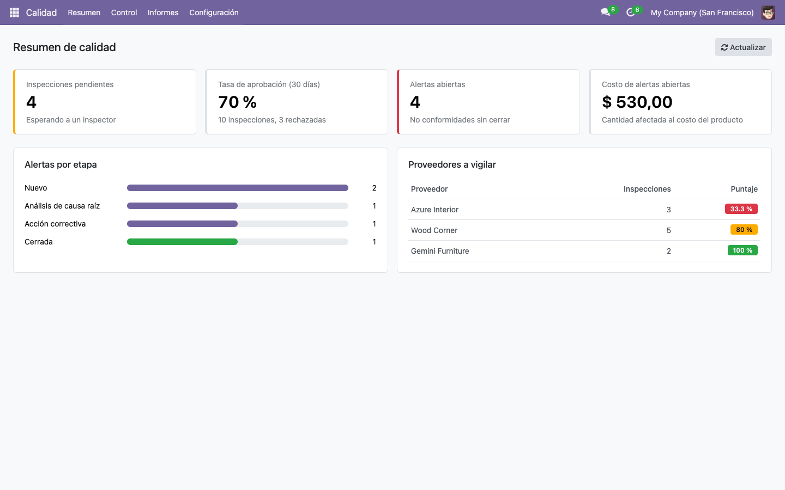
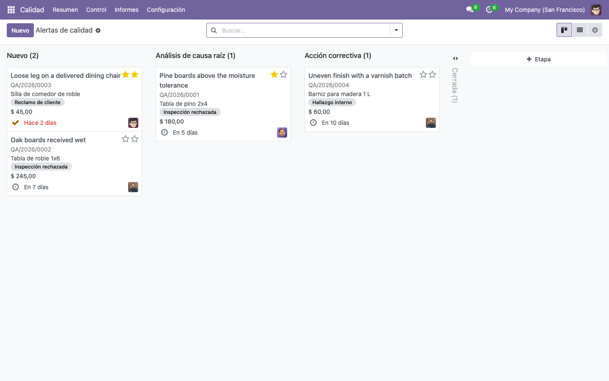
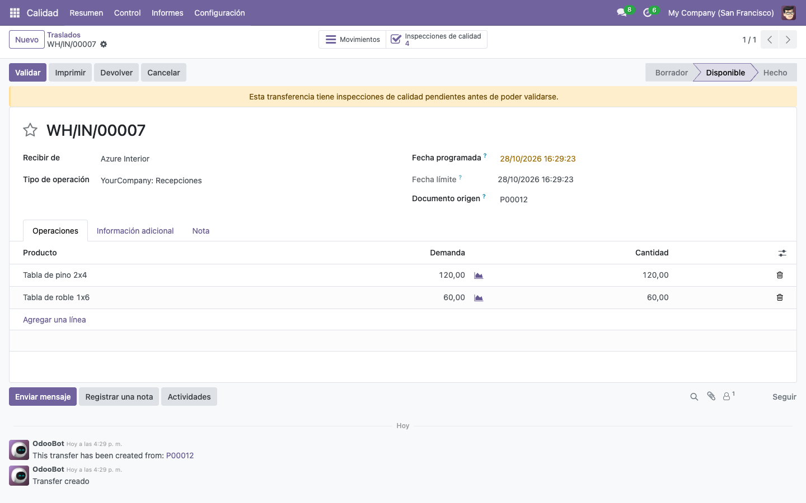
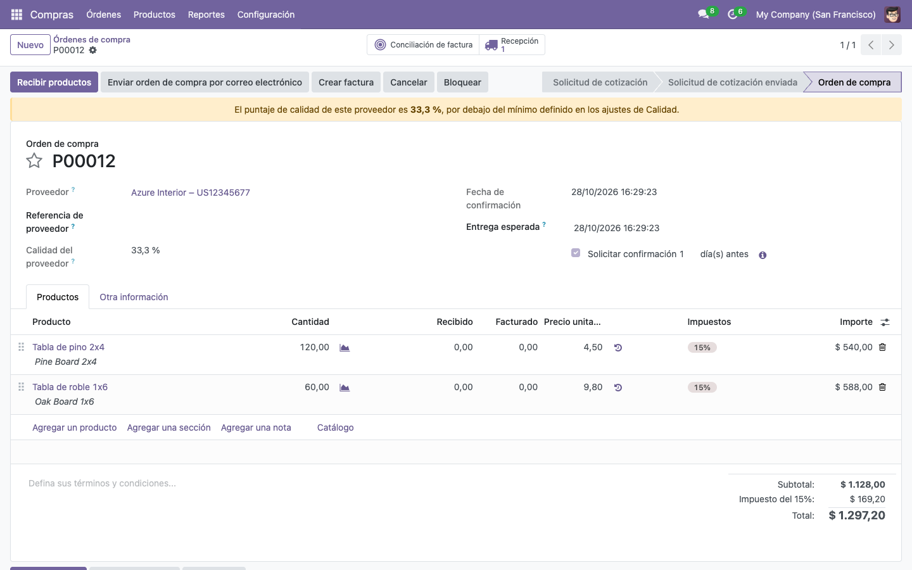
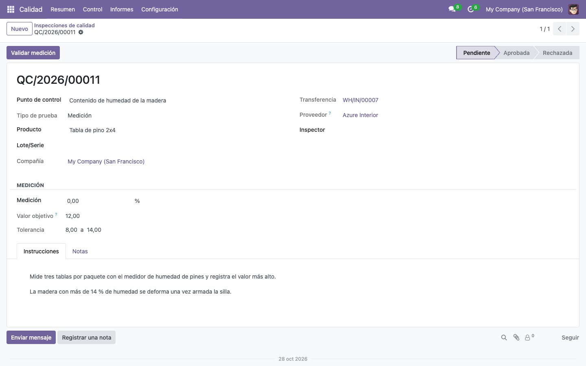
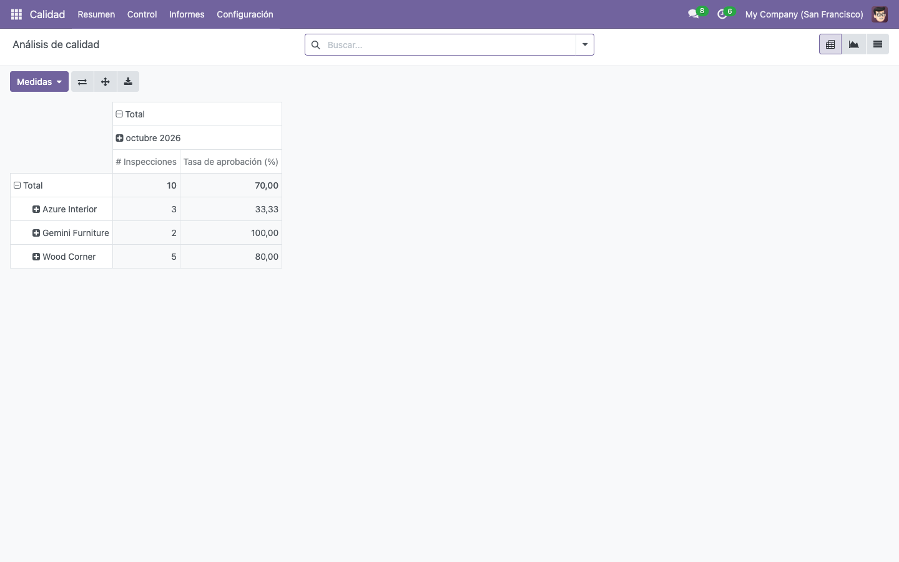
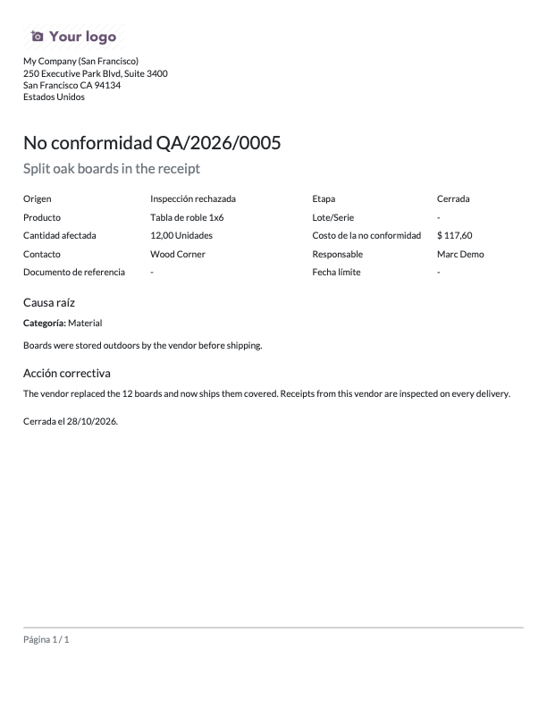

# Control de Calidad para Odoo 18 Community

[](https://github.com/JavierYungaT/odoo18-quality-control/actions/workflows/ci.yml)


Módulo `tk_quality_control`: agrega control de calidad a **Compras, Inventario, Manufactura y Ventas** en Odoo 18 Community. En Odoo, la app oficial de Calidad solo existe en la edición Enterprise.

- **Puntos de control**: qué inspeccionar (aprobado/rechazado o medición con tolerancias) y en qué operaciones.
- **Inspecciones automáticas**: se crean al confirmar recepciones, entregas u órdenes de producción, y **bloquean la validación** mientras estén pendientes o rechazadas sin una no conformidad registrada.
- **Alertas de calidad (no conformidades)**: kanban con responsable, fecha límite, causa raíz (6M), acción correctiva y **costo calculado**.
- **Puntaje de calidad de proveedores**: se muestra en el contacto, y la orden de compra advierte si el proveedor está por debajo del mínimo configurado.
- **Reclamos de clientes**: se registran desde el pedido de venta.
- **Reportes QWeb**: certificado de calidad y no conformidad en PDF; reporte de proveedor en HTML.
- **Dashboard OWL 2** y análisis pivot y gráfico sobre una **vista SQL** de PostgreSQL.
- Interfaz en inglés con **traducción completa al español**.



| Alertas en kanban | Recepción bloqueada por inspecciones |
|---|---|
|  |  |
| **Advertencia en la orden de compra** | **Inspección con medición y tolerancia** |
|  |  |
| **Análisis (vista SQL + pivot)** | **Informe de no conformidad (PDF)** |
|  |  |

## Probarlo en 3 comandos

Requisito: Docker.

```bash
git clone https://github.com/JavierYungaT/odoo18-quality-control.git
cd odoo18-quality-control

docker compose up -d db
docker compose run --rm odoo odoo -d quality -i tk_quality_control --stop-after-init
docker compose up -d odoo
```

Abre <http://localhost:8069> e inicia sesión con usuario `admin` y contraseña `admin`. La base se crea con datos de demostración de un taller de muebles (proveedores de madera, inspecciones, alertas y una compra con su recepción pendiente de inspeccionar) y con el español de Ecuador activado.

**Flujo para probar:** Compras → crear una orden para *Azure Interior* (aparece la advertencia de puntaje bajo) → confirmar → Recibir productos → intentar validar (Odoo lo bloquea) → abrir *Inspecciones de calidad* → registrar las mediciones → crear la alerta de la inspección rechazada → validar la recepción → Imprimir → *Certificado de calidad*.

## Pruebas

```bash
docker compose run --rm odoo odoo -d quality -u tk_quality_control \
  --test-enable --test-tags /tk_quality_control --stop-after-init
```

Son 21 pruebas (`TransactionCase`, `post_install`) que cubren la generación de inspecciones desde transferencias, compras y backorders, el bloqueo de la validación en recepciones y producción, los permisos para reiniciar inspecciones, la conservación de las tolerancias de cada inspección, las tolerancias y restricciones, el puntaje del proveedor, la advertencia en compras, el costo y las reglas de cierre de alertas, los reclamos desde ventas, el cron de vencidas, la vista SQL, el dashboard y el renderizado de los tres reportes. GitHub Actions las corre en cada push ([.github/workflows/ci.yml](.github/workflows/ci.yml)).

## Cómo cubre cada requisito técnico

| Requisito | Dónde está |
|---|---|
| **Python orientado a objetos en Odoo** | Modelos en [models/](addons/tk_quality_control/models): lógica de negocio encapsulada por modelo (`_applies_to`, `_set_result`, `_tk_generate_quality_checks`) y helpers compartidos entre transferencias y producción. |
| **Personalización de módulos estándar** | Herencia (`_inherit`) de `stock.move`, `stock.picking`, `mrp.production`, `purchase.order`, `sale.order`, `res.partner` y `res.config.settings`; overrides de `_action_confirm`, `button_validate` y `button_mark_done`; vistas heredadas con XPath. |
| **Módulo propio** | Cinco modelos nuevos (`tk.quality.point`, `.check`, `.alert`, `.alert.stage`, `.report`), con menús, acciones, secuencias, grupos de seguridad y datos de demo. |
| **QWeb PDF y HTML** | [report/](addons/tk_quality_control/report): certificado de calidad (PDF, en el menú Imprimir de cada transferencia), informe de no conformidad (PDF) e informe de proveedor (HTML). |
| **ORM** | Campos calculados almacenados y no almacenados, calculado editable (`readonly=False`), `related`, `@api.constrains`, `_sql_constraints`, `@api.model_create_multi`, `@api.onchange`, `group_expand`, `_read_group`, `check_company`, índices `btree_not_null`. |
| **PostgreSQL** | Modelo `_auto = False` con `CREATE VIEW` ([tk_quality_report.py](addons/tk_quality_control/models/tk_quality_report.py)); consultas de negocio y de administración (tamaños, índices, `EXPLAIN ANALYZE`, bloqueos, `VACUUM`) en [docs/sql/quality_queries.sql](docs/sql/quality_queries.sql); respaldos con `pg_dump` en la guía de despliegue. |
| **OWL 2 y JavaScript ES6+** | Dashboard como acción de cliente ([static/src/dashboard/](addons/tk_quality_control/static/src/dashboard)): componente con `useState`, `onWillStart`, servicios `orm` y `action`, y plantilla OWL. |
| **Configuración avanzada** | Página propia en Ajustes (parámetro del sistema), acciones de servidor masivas en la lista de inspecciones, cron diario de alertas vencidas, reglas de registro multi-compañía, secuencias y etapas configurables. |
| **Git / GitHub** | Repositorio con CI en GitHub Actions que instala el módulo en una base limpia y corre las pruebas. |
| **Linux Ubuntu** | [docs/despliegue-ubuntu.md](docs/despliegue-ubuntu.md): instalación en Ubuntu 22.04/24.04 con systemd, Nginx, HTTPS con Certbot, actualización del módulo y respaldos. |
| **Scrum** | [docs/backlog.md](docs/backlog.md): historias de usuario con criterios de aceptación, organizadas en sprints. |
| **Ventas, Compras, Inventario, Manufactura, Contabilidad, RRHH** | Reclamos desde ventas · puntaje en compras · bloqueo de recepciones y entregas · inspección de producto terminado · costo de la no conformidad al costo del producto · inspectores y responsables como `hr.employee`. |

### Sobre Odoo Studio

Studio es exclusivo de Odoo Enterprise, así que no forma parte de este módulo Community. Todo lo que aquí está en código (campos, vistas, automatizaciones y reportes) también se podría prototipar con Studio en Enterprise. La diferencia es que Studio guarda los cambios en la base de datos, mientras que un módulo los deja versionados en git, con pruebas y listos para migrar entre versiones.

## Estructura

```
addons/tk_quality_control/
├── __manifest__.py
├── models/            # modelos propios y herencias de módulos estándar
├── views/             # list, form, kanban, search, pivot, graph, ajustes y menús
├── report/            # acciones y plantillas QWeb (PDF y HTML)
├── security/          # grupos, ir.model.access.csv, reglas multi-compañía
├── data/              # secuencias, etapas, cron y acciones de servidor
├── demo/              # escenario de demostración
├── static/src/        # dashboard OWL (JS, XML, SCSS)
├── i18n/              # plantilla .pot y traducción es.po
└── tests/             # pruebas automatizadas
```

Los campos agregados a modelos estándar llevan el prefijo `tk_`, para no chocar con el módulo `quality` de Enterprise si algún día se instalan juntos.

## Traducciones

Los textos fuente están en inglés, como recomienda Odoo, y la traducción está en [i18n/es.po](addons/tk_quality_control/i18n/es.po). Odoo la aplica a cualquier variante de español (es_EC, es_419, es_ES…). Para regenerar la plantilla después de cambiar textos:

```bash
docker compose run --rm odoo odoo -d quality --stop-after-init --modules=tk_quality_control \
  --i18n-export=/mnt/extra-addons/tk_quality_control/i18n/tk_quality_control.pot
```

## Próximos pasos

Muestreo AQL según la cantidad recibida, fotos de evidencia, nota de crédito al proveedor desde la alerta e inspecciones por orden de trabajo. Detalle en el [backlog](docs/backlog.md).

## Autor

**Javier Yunga**, Ingeniero en Ciencias de la Computación.
[LinkedIn](https://www.linkedin.com/in/javier-yunga) · [GitHub](https://github.com/JavierYungaT) · [Portafolio](https://javieryungat.github.io)
